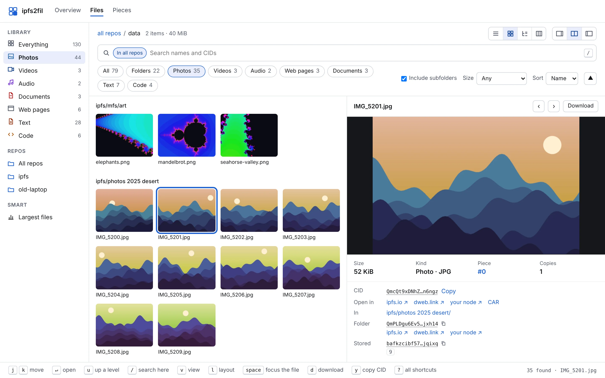
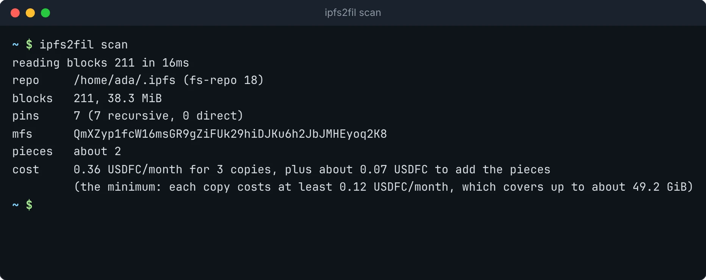
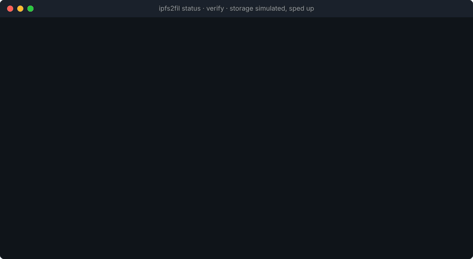
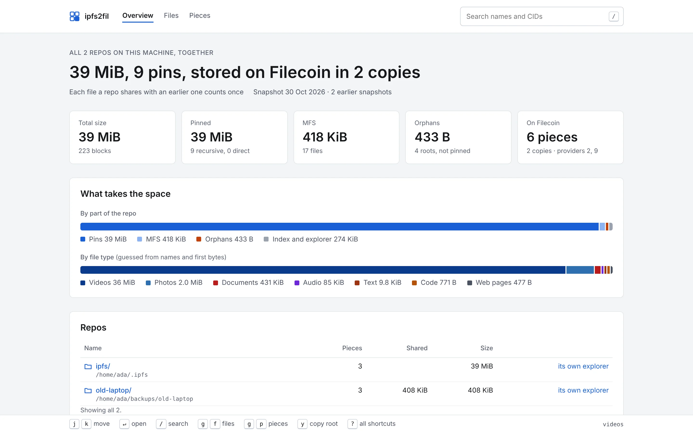
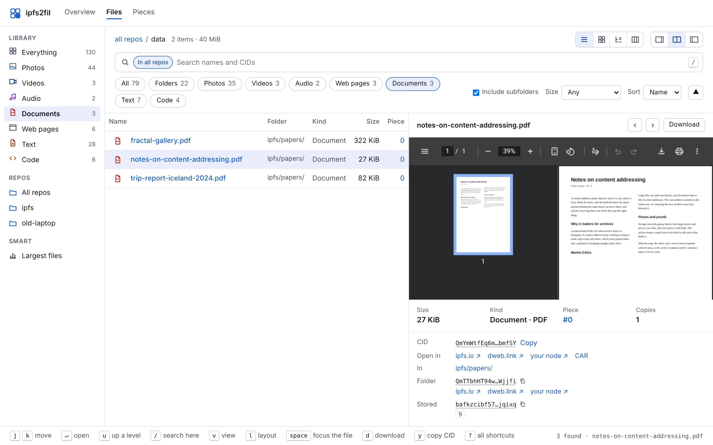
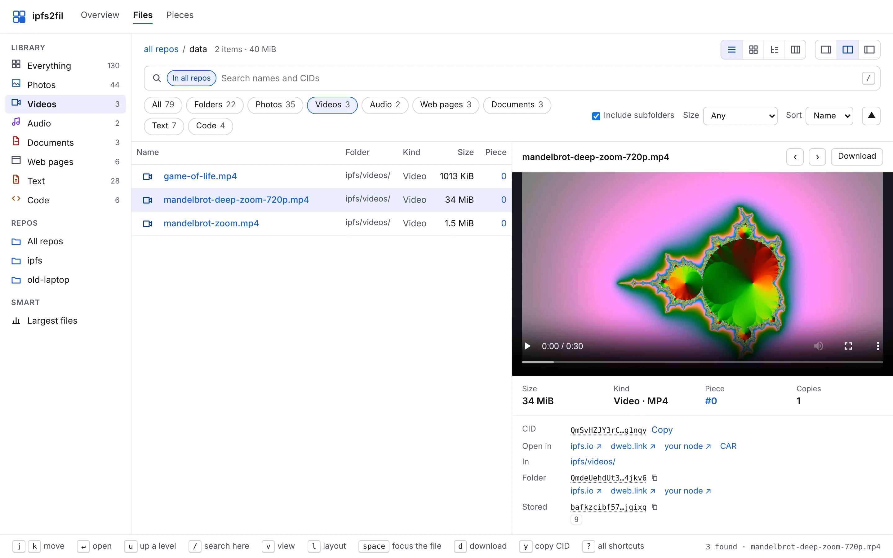
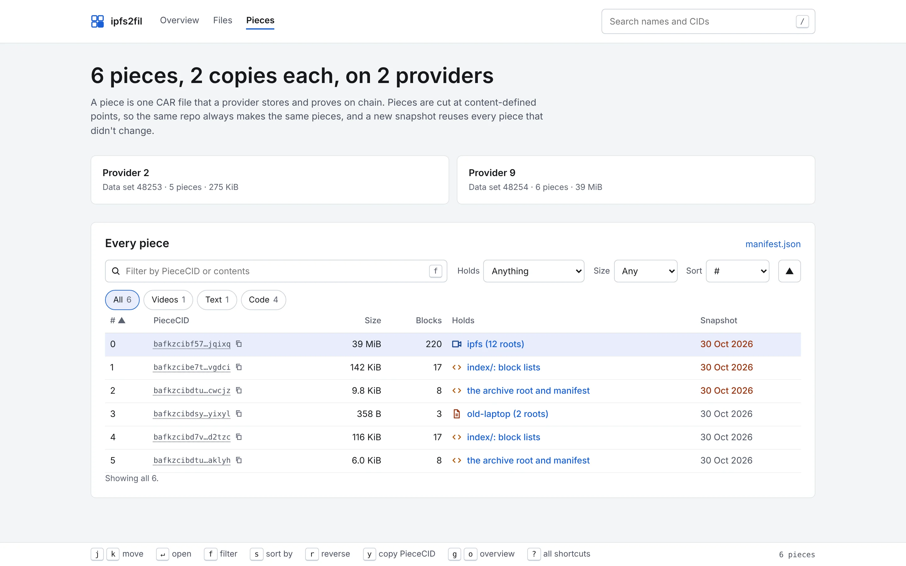

<h1> ipfs2fil</h1>

**Archive your IPFS repos to Filecoin, and browse them from anywhere.**

[Website](https://jbenet.github.io/ipfs2fil/) ·
[Live explorer demo](https://jbenet.github.io/ipfs2fil/demo/all/explorer/) ·
[Install](#install) · [Quickstart](#quickstart) · [Releases](https://github.com/jbenet/ipfs2fil/releases)

`ipfs2fil` reads an IPFS repo of any version (kubo, go-ipfs or IPFS Desktop;
fs-repo 0 through 18), links every pin, the MFS tree and leftover blocks
under one root, cuts the blocks into pieces, and stores 3 copies on Filecoin Onchain Cloud, where
providers keep proving on chain that they hold them. Every archive carries its
own index and an HTML explorer, so any IPFS gateway can serve the files and
show what is where.


<sub>Two made-up repos of a few GiB. The storage is simulated (a test build) and the waits are sped up; everything else is the real tool.</sub>

The explorer, served by `ipfs2fil explore` or by any gateway:



## What you get

- **Every repo version.** fs-repo 0 to 18, go-ipfs 0.2 to kubo 0.43: flatfs,
  leveldb, badger, pebble, custom datastore specs. The repo is only ever read,
  so the daemon can keep running.
- **Everything in it.** Recursive and direct pins, the MFS tree, and orphan
  blocks no pin reaches (on by default).
- **Incremental, deterministic pieces.** Pieces are cut where the content says,
  so the same repo always gives the same pieces. Run it again after the repo
  changes and only the changed pieces upload.
- **Proven copies.** 3 copies by default on Filecoin Onchain Cloud, paid from
  your own wallet. Providers announce the CIDs to IPFS, so any gateway can
  fetch a file by CID.
- **An explorer inside the archive.** Photos, video, audio, PDFs, books, web
  pages, Markdown, spreadsheets, Office files and code open in the page, with
  thumbnails; JavaScript and Python run sandboxed. Every list filters, sorts
  and runs from the keyboard.
- **Many repos, many machines.** Shared data sets, blocks stored once across
  repos, and a catalog of every machine's repos kept encrypted on chain.

## Install

```sh
curl -fsSL https://github.com/jbenet/ipfs2fil/releases/latest/download/install.sh | sh
```

or `go install github.com/jbenet/ipfs2fil/cmd/ipfs2fil@latest`, or download a
binary for your platform from [releases](https://github.com/jbenet/ipfs2fil/releases).
Each release lists SHA-256 checksums and signed build provenance
(`gh attestation verify <file> --repo jbenet/ipfs2fil`).

## Quickstart

You need an IPFS repo from kubo, go-ipfs or IPFS Desktop (the daemon can
keep running) and a Filecoin wallet holding some FIL for gas and USDFC to pay for storage. Add
`--network calibration` to any command to try it free on the testnet.

    ipfs2fil scan              # what would be archived, and what it costs
    ipfs2fil up                # pack and push in one go, after confirming the cost
    ipfs2fil status            # copies, funding, proofs
    ipfs2fil explore           # browse the archive locally

1. **See what you have and what it costs.** Nothing is written.

       ipfs2fil scan

   It reads `$IPFS_PATH`, else `~/.ipfs`; pass `--repo <path>` for another repo.

   

2. **Give it a wallet.** Either make a new one here and fund it:

       ipfs2fil wallet new        # writes ~/.ipfs2fil/wallet.key, prints the address to fund
       ipfs2fil wallet            # FIL, USDFC, and the Filecoin Pay deposit

   or point it at the key of a wallet you already have. ipfs2fil never prints
   the key or copies it anywhere.

       export IPFS2FIL_KEY_FILE=~/secrets/filecoin.key    # or IPFS2FIL_PRIVATE_KEY=<hex>

3. **Archive.** This packs the repo into `./ipfs2fil-archive`, shows the monthly
   cost and any deposit to make into Filecoin Pay, and stores 3 copies once
   you say yes. Each piece is uploaded once; the other providers copy it from
   the first. Uploading and adding pieces on chain are separate steps, so
   uploads keep going while on-chain adds wait out a gas price spike
   (`--max-base-fee`, default 0.1 nanoFIL per gas); the pieces that piled up
   are then added together.

       ipfs2fil up

   Ctrl-C or a failure is safe: run `ipfs2fil up` again and it carries on.
   If the repo has not changed, packing only lists its blocks and keeps the
   last archive; pieces every copy holds are skipped, and the existing data
   sets are reused. Run it again after the repo changes and only the changed
   pieces are written and uploaded.

4. **Check on it, and browse it.**

       ipfs2fil status            # providers, pieces, last proof, days funded
       ipfs2fil verify            # fetch every piece back, check every block, and
                                  # check the CIDs are announced to IPFS
       ipfs2fil explore           # http://127.0.0.1:8484/

   

   Once stored, the archive root printed by `up` opens from any gateway,
   e.g. `https://dweb.link/ipfs/<root>/explorer/`.

The steps of `up` also run on their own: `ipfs2fil pack`, then `ipfs2fil push`.
Every command explains itself: `ipfs2fil help <command>`.

## The explorer

`ipfs2fil explore` serves the archive's explorer along with the files
themselves, read from the pieces on your machine. From a gateway, the same
pages fetch files from the gateway. Press `?` on any page for the keyboard
shortcuts.

| | |
|---|---|
|  |  |
|  |  |

Try it on the [live demo](https://jbenet.github.io/ipfs2fil/demo/all/explorer/),
or on a made-up archive with `ipfs2fil explore --demo`.

explore makes thumbnails of photos, videos, PDFs, album art and Office files
and keeps them in your cache folder; videos, PDFs and album art need `ffmpeg`
and `pdftoppm` (`brew install ffmpeg poppler`). [docs/viewers.md](docs/viewers.md)
lists every viewer and thumbnail and how to add one.

## Many repos

Keep a list of repos and archive them together:

    ipfs2fil repos add ~/.ipfs
    ipfs2fil repos add /Volumes/old/go-ipfs --name old-laptop
    ipfs2fil up --all          # pack and push every repo, one confirmation
    ipfs2fil status --all      # every repo, its copies, proofs and funding
    ipfs2fil explore           # browse all packed repos together (or: explore <name>)

Repos in the list share one set of data sets (one per copy), so setup is paid
once, and a block an earlier repo already stores is not stored again by a later
one. The list and each repo's archive live in `~/.ipfs2fil` (or `--home`, or
`$IPFS2FIL_HOME`); the list holds repo paths and never leaves the machine.
`ipfs2fil repos ls` shows the list, and `ipfs2fil repos rm <name>` takes a repo
off it.

Repos on several machines: give every machine the same wallet key, and run
ipfs2fil on each. There is nothing else to set up or sync: the catalog of
every machine's repos is read from your data sets on chain.

    ipfs2fil repos add ~/.ipfs     # on each machine
    ipfs2fil up --all              # on each machine
    ipfs2fil status --all          # on any machine: every repo on every machine

<details>
<summary>How the catalog works</summary>

An archive's own blocks (its index, explorer and folders) are cut into
small pieces by content, like the data, so a new snapshot re-uploads only
the parts that changed, plus a head piece of a few MB: the root, the
manifest, and a small record naming its machine and repo, encrypted with a
key derived from the wallet key. Another machine lists the data sets'
pieces, reads the first bytes of each new one to find those records, and
downloads only each repo's latest head piece and the pieces holding its
block lists, into `~/.ipfs2fil/chain`. So a repo shows up on other machines
once its pieces are stored, and a machine leaves out blocks that repos on
other machines already store. Repo paths never leave the machine. Machines
are named by `--host`, else the name saved in `~/.ipfs2fil/host` on first use
(on macOS the computer's local name, which, unlike its host name, does not
change with the network).

If two machines push for the very first time at the same moment, both may
create data sets; each then uses the oldest ones, and `status --all` lists
any extra as unused. Running the first `up --all` on one machine avoids it.

A git repository works as the catalog instead (`--catalog
git@github.com:you/ipfs2fil-catalog.git`, or any http(s) URL): ipfs2fil
clones, pulls, commits to and pushes it itself, each machine writing only its
own subfolder. A folder every machine sees works too. The catalog is
remembered; `--catalog filecoin` goes back to reading it from chain.

</details>

## Privacy

Everything ipfs2fil stores on Filecoin is public: storage providers serve
the pieces to anyone, and anyone who has a CID can fetch its blocks,
including the archive's index and explorer with their file names. Only
the small catalog records naming your machines and repos are encrypted. To
keep something private, encrypt it before adding it to IPFS.

`ipfs2fil explore` listens on 127.0.0.1 and answers only requests addressed
to localhost or an IP address, so web pages cannot reach it through DNS
rebinding.

## Development

    go test ./...
    go run ./cmd/ipfs2fil explore --demo       # preview the explorer on a made-up archive
    go run ./cmd/ipfs2fil explore --feedback   # Alt+F files explorer feedback into
                                               # ~/.ipfs2fil/feedback/issues (never in archives)

How the pieces fit: [docs/ARCHITECTURE.md](docs/ARCHITECTURE.md). Design
notes: the [plan](https://claude.ai/artifact/KfFPmyzZdSsVRbRD2mN2gE) and the
[explorer designs](https://claude.ai/artifact/XpKa96RnjJz32GJ5eqTQGK) (sources
in docs/boards).

The website is [site/](site/), published to GitHub Pages by
[.github/workflows/pages.yml](.github/workflows/pages.yml). Its recordings and
screenshots are of two made-up demo repos; [scripts/site](scripts/site/)
has the tools that made them and the live explorer demo.

To cut a release: `git tag v0.1.0 && git push origin v0.1.0`.

## License

MIT, see [LICENSE](LICENSE).
